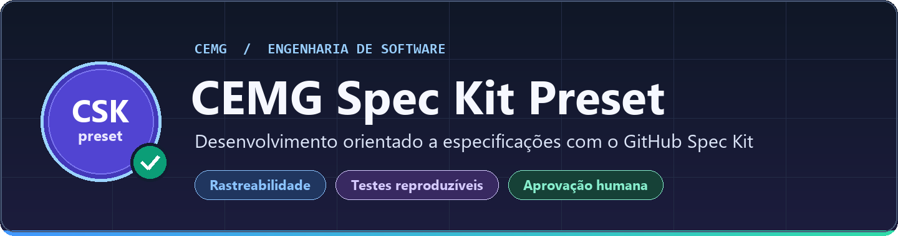

<p align="center">
  
</p>

<p align="center">
  
  
  
</p>

<p align="center">
  <a href="#instalacao">Instalação</a> ·
  <a href="#vitrine-do-preset">Vitrine do preset</a> ·
  <a href="docs/ADOCAO.md">Guia de adoção</a> ·
  <a href="docs/CONTROLES.md">Controles</a> ·
  <a href="docs/VALIDACAO.md">Validação técnica</a> ·
  <a href="#autor-e-contato">Contato</a> ·
  <a href="LICENSE.txt">Licença</a>
</p>

---

## Visão geral

O **CEMG Spec Kit Preset** padroniza o desenvolvimento assistido por IA com **requisitos rastreáveis**, **testes reproduzíveis**, **revisão técnica com evidências** e **aprovação humana**. Foi validado com **Codex**, **GitHub Copilot**, **Antigravity**, **Claude Code** e **Kiro CLI**.

| Etapa | Engenharia | Validação e aceite |
| --- | --- | --- |
| Especificação | Vincula requisitos, critérios de aceite e cenários de teste. | Esclarece decisões de negócio que afetam escopo ou comportamento. |
| Implementação | Divide o trabalho em PRs verificáveis e revisa o diff com base nos requisitos. | Registra os resultados de testes e a execução pelo meio real de uso. |
| Entrega | Organiza evidências e registros de prontidão vinculados à revisão do código. | O DEV valida em homologação, o usuário final executa o UAT e o PO participa do aceite de produção. |

## Vitrine do preset

### Da história de usuário ao PR

O exemplo de cadastro de cliente reúne especificação, decisões de planejamento, tarefas e roteiro funcional. O exemplo de PRs mostra como dividir a entrega em incrementos verificáveis. [História de cadastro](examples/US1-cadastro.md) · [Divisão em PRs](examples/US1-prs.md)

### Da execução ao aceite

O preset fornece modelos para registrar a execução técnica, orientar o teste do usuário final e formalizar o aceite da história. [Roteiro DEV](templates/dev-validation-template.md) · [Roteiro UAT](templates/uat-validation-template.md) · [Termo de aceite](templates/acceptance-template.md)

## Por que usar este preset e quais os ganhos?

No fluxo padrão de desenvolvimento assistido por IA (mesmo com Spec Kit puro),
é comum que agentes gerem código rapidamente, mas tratem testes como opcionais,
assumam decisões de negócio sem perguntar, declarem tarefas "concluídas" apenas
porque compilaram ou passaram em um mock isolado e entreguem PRs grandes demais
para revisão humana confiável.

O `cemg-speckit-preset` transforma o Spec Kit em um **processo de engenharia auditável,
orientado a evidências e com governança humana explícita**. Principais ganhos:

- **Fim do "compilou, está pronto" (Validação e Execução Reproduzível)**:
  testes deixam de ser opcionais. Além de testes automatizados, a IA é obrigada
  a iniciar e acionar o produto pelo meio real de uso (UI, API, CLI, mensageria,
  job ou biblioteca), observar o resultado e registrar evidências verificáveis
  antes de disponibilizar a entrega.
- **Zero decisões críticas adivinhadas pela IA**: elimina o limite artificial de
  perguntas na etapa de especificação/clarificação para decisões materiais (escopo,
  segurança, comportamento e aceite). A IA para e pergunta em vez de "chutar"
  regras de negócio silenciosamente.
- **Rastreabilidade ponta a ponta**: cada requisito (`RF`/`RNF` ou `FR`/`NFR`),
  critério de aceite (`USn-ACnn`) e cenário de teste (`USn-Snn`) é vinculado
  diretamente às tasks em `tasks.md`, aos PRs planejados, às evidências de teste
  e ao termo de aceite.
- **PRs menores, seguros e fáceis de revisar**: exige planejamento prévio da
  divisão em PRs por coesão funcional, complexidade e capacidade de verificação,
  garantindo que incrementos intermediários mantenham o sistema em estado seguro.
- **Revisão técnica estruturada com evidências**: antes de pedir revisão humana,
  a IA executa um review contra o diff real e os requisitos, documentando achados
  impeditivos, regressões e revalidações após correções.
- **Roteiros prontos para DEV (Homologação) e Usuário Final (UAT / Produção)**:
  gera automaticamente dois planos de validação distintos por história — um
  roteiro técnico reproduzível para o DEV (`validation/USx-dev.md`) e um roteiro
  em linguagem de negócio para o Usuário Final (`validation/USx-uat.md`).
- **Governança humana inegociável**: separa claramente o que a IA faz do que é
  responsabilidade humana. A IA nunca aprova PRs, nunca assina aceite de
  homologação (exclusivo do DEV) ou de produção (exclusivo do Usuário Final + PO)
  e nunca mascara falhas ou impossibilidades técnicas como testes aprovados.
- **Gates verificáveis por hash (SHA-256)**: inclui ferramentas locais
  (`check_gate.py` e `record_test.py`) que validam integridade das evidências,
  logs de execução, vínculo com o commit/revisão exato do código e presença das
  aprovações humanas exigidas em cada estágio.

## O que fornece

- Templates de spec, plan e tasks com rastreabilidade e validação obrigatória.
- Evidências de execução e review, roteiro do DEV, aceite e descrição de PR.
- Política de PRs por escopo, complexidade e possibilidade de teste.
- Adendo ao modelo de constituição e dez comandos habituais personalizados.
- Exemplos, instruções de adoção e relatório de validação técnica.

## Compatibilidade e pré-requisitos

Requer Spec Kit `>=1.1.3` (versão base verificada: 1.1.3) e **Python 3.11+** disponível no terminal.
Os comandos preservam snapshots do fluxo oficial 1.1.3 e o manifesto permite
instalação em qualquer versão igual ou superior a 1.1.3.

> [!IMPORTANT]
> **Dependência do Python e do CLI `specify` no `PATH` (Windows/PowerShell)**
>
> O Spec Kit (`specify`) e as ferramentas deste preset (`check_gate.py`, `record_test.py` e `verify_package.py`) dependem do Python no `PATH`. Em ambientes Windows onde o Python não foi adicionado ao `PATH` (ou onde o `specify` foi instalado via `uv tool`), comandos como `python` ou `specify` podem falhar com *"não é reconhecido como um nome de um cmdlet..."*.
>
> **Como verificar e resolver:**
> 1. **Se o Python Launcher (`py`) estiver instalado**: você pode substituir `python` por `py` ao rodar scripts (ex.: `py tools/verify_package.py`).
> 2. **Para adicionar o Python e o `specify` ao `PATH` do seu usuário no Windows (PowerShell)**:
>    ```powershell
>    # Exemplo adicionando Python 3.12 local e a pasta de binários do uv/specify ao PATH do usuário:
>    $userPath = [Environment]::GetEnvironmentVariable("Path", "User")
>    $novosCaminhos = @(
>        "$env:LOCALAPPDATA\Programs\Python\Python312",
>        "$env:LOCALAPPDATA\Programs\Python\Python312\Scripts",
>        "$env:USERPROFILE\.local\bin"
>    )
>    foreach ($p in $novosCaminhos) {
>        if ((Test-Path $p) -and ($userPath -notlike "*$p*")) {
>            $userPath = "$userPath;$p"
>        }
>    }
>    [Environment]::SetEnvironmentVariable("Path", $userPath, "User")
>    ```
>    *(Feche e reabra o terminal/IDE após executar para recarregar o `PATH`, e confirme com `python --version` e `specify --version`).*
> 3. **Se ainda não tiver o Python instalado**: instale via `winget install Python.Python.3.12` (ou pelo instalador oficial em python.org marcando a opção **"Add python.exe to PATH"**).

Os comandos usuais continuam sendo speckit.specify, speckit.plan, speckit.tasks
e demais comandos. O nome e a forma de invocação dependem da integração (suportando
Codex, GitHub Copilot, Antigravity, Claude Code e Kiro CLI); em integrações com
skills são usados `$speckit-specify` / `/speckit-specify` e assim por diante.
Não há executável separado nem necessidade de renomear o CLI specify.

<a name="instalacao"></a>

## Como aplicar o preset (Nova aplicação vs. Aplicação existente)

Antes de começar, tenha este pacote (`cemg-speckit-preset`, pasta que contém o `preset.yml`) em um diretório local acessível (ex.: `C:\Projetos\cemg-speckit-preset`).

Escolha a chave da sua integração de IA para usar no parâmetro `--integration`:
- **Codex**: `codex`
- **GitHub Copilot**: `copilot`
- **Antigravity**: `agy`
- **Claude Code**: `claude`
- **Kiro CLI**: `kiro-cli`

---

### Cenário 1: Em uma NOVA aplicação (do zero)

Use este fluxo quando estiver criando um projeto novo:

```powershell
# 1. Crie a pasta do novo projeto e entre nela
mkdir C:\Projetos\MinhaNovaApp
cd C:\Projetos\MinhaNovaApp

# 2. Inicialize o Spec Kit escolhendo o seu agente (ex.: agy, codex, copilot, claude ou kiro-cli)
specify init --here --integration agy

# 3. Instale o preset cemg-speckit-preset apontando para a pasta onde está o preset.yml
specify preset add --dev "C:\Projetos\cemg-speckit-preset"

# 4. Confirme que o preset e os templates/comandos estão ativos
specify preset list
specify preset info cemg-speckit-preset
specify preset resolve spec-template
specify preset resolve speckit.tasks
```

Depois disso, abra o projeto na sua IDE/agente e inicie pelo comando de constituição (`/speckit-constitution` ou `$speckit-constitution`) para estabelecer os princípios do projeto já com o adendo de qualidade da CEMG.

---

### Cenário 2: Em uma aplicação EXISTENTE que AINDA NÃO usa Spec Kit

Use este fluxo quando o projeto já tem código-fonte em andamento, mas nunca teve o Spec Kit configurado (`.specify/` ainda não existe):

```powershell
# 1. Entre na pasta da aplicação existente e crie uma branch dedicada
cd C:\Projetos\MinhaAppExistente
git checkout -b chore/adotar-cemg-speckit-preset

# 2. Inicialize o Spec Kit no diretório atual (--force permite rodar em pasta não vazia sem apagar seu código)
specify init --here --force --integration agy

# 3. Instale o preset cemg-speckit-preset
specify preset add --dev "C:\Projetos\cemg-speckit-preset"

# 4. Verifique a instalação e o diff gerado no Git
specify preset list
specify preset resolve speckit.specify
git status
```

> [!NOTE]
> O comando `specify init --here --force` cria apenas a estrutura `.specify/` e a pasta de skills/comandos do agente escolhido (ex.: `.agents/skills/`, `.github/skills/`, `.claude/skills/` ou `.kiro/prompts/`), sem tocar no código-fonte da sua aplicação.

---

### Cenário 3: Em uma aplicação EXISTENTE que JÁ usa Spec Kit

Use este fluxo quando o projeto já possui `.specify/` inicializado (e possivelmente specs ou constituição anteriores):

```powershell
# 1. Entre na pasta do projeto e crie uma branch para registrar a adoção do preset
cd C:\Projetos\MinhaAppComSpecKit
git checkout -b chore/atualizar-cemg-speckit-preset

# 2. Instale o preset cemg-speckit-preset (ou use 'preset update' se já tiver versão anterior instalada)
specify preset add --dev "C:\Projetos\cemg-speckit-preset"
# Caso já exista uma versão anterior de cemg-speckit-preset instalada:
# specify preset update cemg-speckit-preset --dev "C:\Projetos\cemg-speckit-preset"

# 3. Confirme se a camada vencedora (top layer) de templates e comandos é o cemg-speckit-preset
specify preset list
specify preset info cemg-speckit-preset
specify preset resolve spec-template
specify preset resolve speckit.tasks
```

**Cuidados importantes em projetos que já usam Spec Kit:**
- `--dev` **copia** o pacote para `.specify/presets/cemg-speckit-preset/` dentro do projeto alvo; alterações futuras na pasta de origem exigem `specify preset update`.
- Instalar o preset **atualiza os comandos do agente e templates futuros**, mas **não reescreve automaticamente** `specs/` antigas nem sobrescreve um `.specify/memory/constitution.md` que já tenha sido preenchido pela equipe.
- Para incorporar as novas regras de qualidade à constituição existente do projeto, reinicie a sessão do agente (para recarregar as skills) e execute conscientemente o comando `/speckit-constitution` (ou `$speckit-constitution`).
- Se o projeto tiver arquivos em `.specify/templates/overrides/`, lembre-se de que overrides locais têm prioridade maior que presets. Ver `docs/ADOCAO.md` para detalhes de prioridade, atualização e remoção.

## Estrutura do repositório

| Diretório / Arquivo | Descrição |
|---|---|
| `preset.yml` | Manifesto oficial do preset (ID `cemg-speckit-preset`, versão `1.0.0` e lista das 24 contribuições). |
| `commands/` | Os 10 comandos/skills do Spec Kit (`constitution`, `specify`, `clarify`, `plan`, `tasks`, `analyze`, `checklist`, `implement`, `converge` e `taskstoissues`) com o contrato obrigatório CEMG. |
| `templates/` | 14 templates (Markdown e JSON) para especificação, plano, tasks, evidências de validação/review, descrição de PR, roteiros DEV/UAT, aceite e registro de impossibilidade. |
| `policies/` | Políticas normativas de qualidade (`QUALIDADE.md`), condições de passagem (`PASSAGENS.md`), divisão de PRs (`POLITICA-PRS.md`), execução reproduzível (`EXECUCAO-REPRODUZIVEL.md`) e requisitos de gates (`gate-requirements.json`). |
| `tools/` | Utilitários em Python para verificação de prontidão e hashes (`check_gate.py`), coleta auditável de execução de testes (`record_test.py`) e integridade do pacote (`verify_package.py`). |
| `tests/` | Suíte automatizada de testes de unidade/integração dos gates (`test_gate.py`). |
| `examples/` | Exemplo de workflow de CI (`quality-gates.yml`) e exemplos didáticos de história e divisão de PRs (`US1-cadastro.md`, `US1-prs.md`). |
| `docs/` | Guias de adoção (`ADOCAO.md`), controles (`CONTROLES.md`), execução (`EXECUCAO.md`), versionamento (`VERSIONAMENTO.md`), relatórios de validação (`VALIDACAO.md`, `VALIDACAO.json`), proveniência (`PROVENIENCIA.json`) e histórico (`CHANGELOG.md`). |
| `checksums.json` | Manifesto de integridade SHA-256 de todos os arquivos distribuídos no pacote. |
| `LICENSE.txt` / `NOTICE.md` | Termos de licenciamento do preset e aviso de atribuição ao GitHub Spec Kit (`LICENSE-SPEC-KIT.txt`). |

## Verificação de integridade e testes do pacote

Para validar a integridade dos hashes (`checksums.json`) e executar a suíte de 20 testes automatizados dos gates localmente:

```powershell
# Verificar integridade de todos os arquivos do pacote contra preset.yml e checksums.json
python tools/verify_package.py

# Executar a suíte de testes automatizados dos gates de qualidade
python -m unittest discover -s tests
```

*(Caso `python` não esteja no `PATH` no Windows, utilize `py tools/verify_package.py` e `py -m unittest discover -s tests`).*

## Escopo da garantia

O relatório de validação distingue instalação/resolução de execução funcional.
O smoke test não comprova que uma IA cumprirá todo o processo em um projeto real.
Planejar um piloto com a equipe. Não inclui ativação automática de CI, proteção de
branch, publicação remota nem automatização de abertura ou merge de PRs.

## Versões e convivência

O ID permanece `cemg-speckit-preset`. A pasta ou arquivo ZIP de distribuição pode
incluir `1.0.0` para identificar a release. Projetos diferentes podem adotar
releases diferentes; no mesmo projeto, manter uma única versão ativa. Ver
`docs/VERSIONAMENTO.md` e `docs/VALIDACAO.md`.

## Controles e execução reproduzível

Esta versão consolida condições obrigatórias de passagem, esclarecimentos sem
quota artificial, análise impeditiva, review mínimo e roteiros com estados
separados para DEV (Homologação) e Usuário Final (Produção), além de verificador
local de registros, coletor de execução, exemplo de CI e guia de proteção de branch.
Esses controles de CI e repositório não são ativados automaticamente. Ver
`docs/CONTROLES.md` e `docs/TABELA-REVISAO.md`.

A política de execução exige acionar o comportamento real do produto e observar
o resultado com ou sem tela. Quando houver impedimento técnico real no ambiente
do DEV, ele pode confirmar a impossibilidade e decidir explicitamente entre
`AGUARDAR`, `REJEITAR` ou `ACEITAR_COM_RESSALVAS`, usando modelos Markdown/JSON
e verificação estrutural específica sem converter impossibilidade em teste aprovado.
Ver `policies/EXECUCAO-REPRODUZIVEL.md` e `docs/EXECUCAO.md`.

## Autor e contato

<p align="center">
  
</p>

<p align="center">
  <a href="mailto:wagner@cemg-tecinfo.com"></a>
  <a href="https://br.linkedin.com/in/carlos-wagner-g-bittencourt-847902114"></a>
</p>

## Licenciamento
- **Licença do preset (`LICENSE.txt`)**: Uso livre em projetos próprios, **proibida a distribuição ou redistribuição por terceiros** sem autorização expressa do autor. O software é disponibilizado **"COMO ESTÁ" ("AS IS")**, sem garantias de qualquer tipo, não se responsabilizando o autor por quaisquer danos decorrentes do seu uso.
- **Componentes de terceiros (`LICENSE-SPEC-KIT.txt` e `NOTICE.md`)**: Os snapshots base em `commands/speckit.*.md` derivam do GitHub Spec Kit 1.1.3 (Copyright (c) GitHub, Inc., sob licença MIT).
